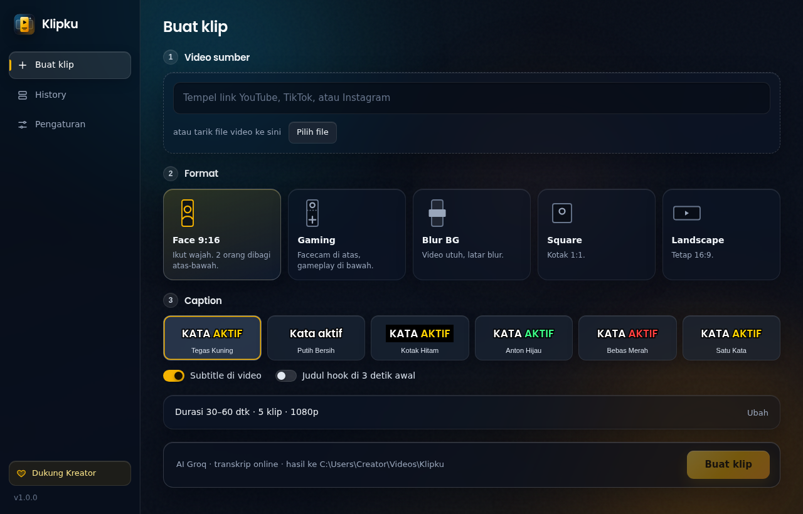
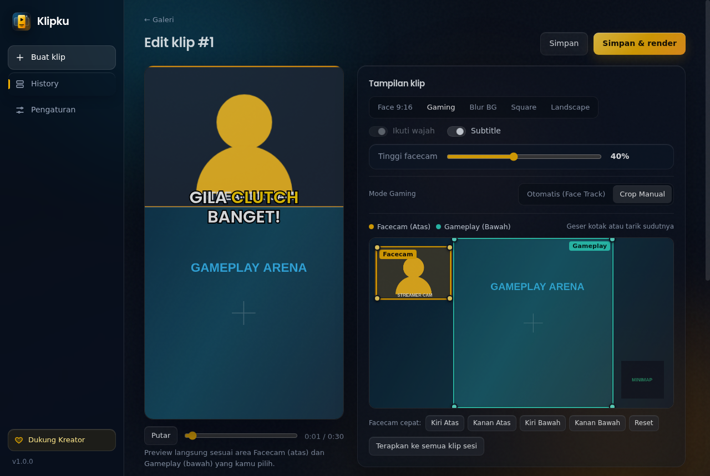

<div align="center">
  
  <h1>Klipku</h1>
  <p>
    <strong>Ubah video panjang jadi klip pendek siap upload (TikTok, Reels, YouTube Shorts) otomatis dengan AI.</strong><br/>
    100% gratis, tanpa langganan, tanpa watermark paksa, jalan lokal di PC Windows-mu.
  </p>

  <p>
    <a href="https://github.com/creative273/klipku/releases/latest">
      
    </a>
    <a href="https://www.youtube.com/@misterisia?sub_confirmation=1">
      
    </a>
    <a href="https://saweria.co/rayacill">
      
    </a>
  </p>

  <p>
    
    
    
  </p>
</div>

<br/>

<p align="center">
  
</p>

---

## Kenapa Pakai Klipku?

Capek harus bayar langganan mahal tiap bulan atau kena watermark gede cuma buat motong video podcast, vlog, atau live gaming jadi klip pendek?

**Klipku** dirancang khusus buat kreator Indonesia (dan global) yang mau alur kerja **cepat, lokal, dan gratis**:

- **Tempel Link atau Tarik File Video** — Mendukung link YouTube, TikTok, Instagram (via `yt-dlp`), atau langsung drag-and-drop file lokal (`MP4`, `MOV`, `MKV`, `WEBM`, `AVI`).
- **AI Pintar Pilih Momen Terbaik** — Membaca seluruh transkrip, memilih momen yang utuh (awal kuat, akhir tuntas), memberi skor **Hook · Flow · Value**, dan otomatis membuat **judul hook gaya AIDA**.
- **Transkrip Online Super Cepat atau 100% Offline** — Pakai **Groq Whisper** (gratis & kencang) atau jalankan **Faster-Whisper offline** langsung di CPU laptop tanpa internet dan tanpa API key.
- **5 Format Klip + Auto Face Tracking** — Otomatis mengikuti wajah pembicara, bahkan otomatis membagi layar atas-bawah untuk shot 2 orang (podcast/wawancara).
- **Mode Gaming: Auto Facecam & Crop Manual + Live Preview** — Deteksi kotak webcam otomatis *atau* pilih sendiri area **Facecam (atas)** dan **Gameplay (bawah)** dengan kotak geser/resize interaktif, rasio anti-gepeng, plus 1 klik terapkan ke semua klip dalam satu sesi.
- **Caption Editor Word-by-Word** — 6 preset gaya caption siap pakai + buat preset warna/font/posisi sendiri, koreksi kata yang salah ketik, overlay judul hook di 3 detik awal, serta watermark logo/teks opsional.
- **Aman & Praktis** — Semua proses render berjalan lokal dengan FFmpeg. API key disimpan terenkripsi di **Windows Credential Manager**, bukan di file teks. Update `yt-dlp` dan cek versi Klipku terbaru bisa langsung dari dalam Pengaturan.

<p align="center">
  
  <br/>
  <sub><i>Editor Klip — Mode Crop Manual untuk Gaming: atur sendiri kotak Facecam & Gameplay sambil melihat preview 9:16 secara langsung.</i></sub>
</p>

---

## Format Klip yang Didukung

| Format | Rasio | Cocok Untuk |
| :--- | :---: | :--- |
| **Face 9:16** | `9:16` | Podcast, talking head, wawancara. Otomatis mengikuti wajah & membagi 2 orang atas-bawah. |
| **Gaming** | `9:16` | Live stream / gameplay. Facecam di atas (`25%–60%`), gameplay di bawah. Bisa **Face Track otomatis** atau **Crop Manual**. |
| **Blur BG** | `9:16` | Video presentasi / sinematik yang ingin tetap tampil utuh dengan latar belakang blur. |
| **Square** | `1:1` | Feed Instagram, Facebook, atau LinkedIn dengan auto face tracking. |
| **Landscape** | `16:9` | Highlight YouTube biasa atau kompilasi video horizontal. |

Resolusi output tersedia mulai dari **720p**, **1080p**, **2K**, hingga **4K**.

---

## Cara Mulai dalam 3 Menit

### 1. Download & Install
1. Buka halaman **[Releases](https://github.com/creative273/klipku/releases/latest)** (atau tab **[Actions](https://github.com/creative273/klipku/actions)** untuk build terbaru) lalu unduh **`Klipku-Setup-1.2.0-win-x64.exe`**.
2. Jalankan installer seperti biasa (semua mesin Python, FFmpeg, Deno, dan model deteksi wajah sudah ikut di dalam installer — tidak perlu install apa pun lagi).
   > **Catatan Windows SmartScreen:** Karena aplikasi ini gratis & open-source (belum menggunakan sertifikat berbayar), Windows mungkin menampilkan *"Windows protected your PC"*. Klik **More info → Run anyway** untuk melanjutkan.

### 2. Pasang API Key Gratis (Cukup Sekali)
Buka menu **Pengaturan** di dalam Klipku:
- **Paling Praktis (Direkomendasikan):** Buat API key gratis di [Groq Console](https://console.groq.com/keys), tempel di kolom Groq, lalu klik **Simpan**. Satu key Groq sudah bisa dipakai untuk **Transkrip Online** sekaligus **AI Pemilih Momen**.
- **Alternatif AI lain:** Bisa juga menggunakan **Gemini** ([Google AI Studio](https://aistudio.google.com/apikey)) atau **OpenRouter** ([openrouter.ai/keys](https://openrouter.ai/keys)).
- **Tanpa API Key untuk Transkrip:** Ubah mode transkrip ke **Offline** lalu unduh model `Small` (~480 MB) atau `Large v3 Turbo` (~1,6 GB) langsung dari Pengaturan.

### 3. Buat Klip Pertamamu
1. Tempel link YouTube/TikTok/Instagram **atau** tarik file video dari laptop ke halaman **Buat klip**.
2. Pilih **Format** (`Face 9:16`, `Gaming`, dll.) dan **Gaya Caption**.
3. Klik **Buat klip** dan tunggu progresnya selesai.
4. Setelah jadi, kamu bisa klik **Edit** di kartu klip mana saja untuk mengedit teks caption, ganti judul hook dengan AI, atau atur **Crop Manual** untuk Gaming, lalu klik **Simpan & render**.

---

## Pertanyaan Umum (FAQ)

<details>
<summary><b>Apakah Klipku benar-benar 100% gratis?</b></summary>
<p>Ya! Klipku gratis dipakai tanpa batas jumlah klip dan tanpa watermark paksa. Kamu hanya memakai API key gratis milikmu sendiri (Groq / Gemini / OpenRouter), dan seluruh render video dilakukan lokal di komputermu.</p>
</details>

<details>
<summary><b>Apakah butuh GPU / kartu grafis mahal?</b></summary>
<p>Tidak. Klipku dirancang supaya tetap jalan di laptop biasa (CPU). Deteksi wajah memakai model ringan YuNet dan encode menggunakan FFmpeg <code>libx264</code>.</p>
</details>

<details>
<summary><b>Kenapa download link YouTube tiba-tiba gagal?</b></summary>
<p>YouTube sering memperbarui sistemnya. Buka <b>Pengaturan → Mesin aplikasi → Update yt-dlp</b>, lalu buka ulang Klipku. Biasanya langsung normal kembali.</p>
</details>

<details>
<summary><b>Bagaimana cara update Klipku ke versi terbaru?</b></summary>
<p>Klipku otomatis mengecek pembaruan saat dibuka (muncul notifikasi di sidebar kiri bawah), atau kamu bisa buka <b>Pengaturan → Mesin aplikasi → Cek versi terbaru</b> lalu klik <b>Update sekarang</b> untuk mengunduh (terverifikasi SHA256) dan memasang pembaruan langsung dari dalam aplikasi.</p>
</details>

---

## Dukung Pengembangan Klipku

Klipku dibagikan gratis untuk siapa pun yang terbantu. Kalau aplikasi ini bermanfaat buat kontenmu, kamu bisa bantu kasih semangat untuk update fitur berikutnya lewat:

- **Subscribe YouTube:** [youtube.com/@misterisia](https://www.youtube.com/@misterisia?sub_confirmation=1)
- **Traktir Seikhlasnya via Saweria:** [saweria.co/rayacill](https://saweria.co/rayacill)
- **Kasih Star ⭐** di repo GitHub ini supaya makin banyak kreator yang nemu!

---

## Untuk Developer (Build Sendiri)

Klipku dibangun dengan arsitektur ringan tanpa framework berat:
- **`electron/`** — Proses utama Electron + bridge IPC aman (`contextIsolation: true`).
- **`backend/`** — Server lokal FastAPI (`127.0.0.1` + token acak per sesi), SQLite (`klipku.db`), pipeline `fetch → transcribe → detect → tracking → render` dengan `yt-dlp`, `faster-whisper`, OpenCV YuNet, dan FFmpeg/libass.
- **`ui/`** — Antarmuka Vanilla HTML/CSS/JS bergaya *frosted glass*.
- **`scripts/fetch-engine.ps1`** & **`.github/workflows/build.yml`** — Menyiapkan bundle Python embeddable, FFmpeg, Deno, model YuNet, font Google OFL, menjalankan smoke test, dan membangun installer NSIS Windows x64 (`npm run dist`).

```powershell
# Di Windows (PowerShell):
./scripts/fetch-engine.ps1
npm ci
npm run dist
```
